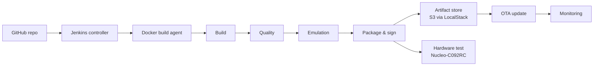

# Edge Appliance DevOps

CI/CD pipeline for an embedded home-appliance controller: build, test, emulate, sign, and release Zephyr firmware, with hardware-in-the-loop testing on a real STM32 board.

> **Status:** work in progress. See the roadmap for what is done.

## Why this project exists

This is a learning project focused on the **Embedded DevOps** role: everything around the firmware, not the firmware itself. The firmware is deliberately simple. The pipeline is the point.

## Roles

| Firmware side (provided) | DevOps side (this repo's focus) |
|---|---|
| Zephyr app, board overlays, unit tests | Reproducible builds, CI, quality gates |
| Defines expected behavior (the "contract") | Automates verification, signing, release, OTA |

## Architecture



## Targets

| Stage | Target | Purpose |
|---|---|---|
| Smoke test | QEMU (`qemu_cortex_m3`) | Fast checks, no hardware |
| Emulated tests | Renode (STM32F4 family) | Peripheral-level tests |
| Hardware tests | Nucleo-C092RC (STM32C092RC) | Real-device verification |

Renode does not support STM32C0, so emulation and hardware use different boards. The same Robot Framework suites check the same behavior on both. See `docs/decisions.md`.

## Tech stack

Zephyr RTOS, West, Docker, Jenkins, GitHub Actions, SonarQube, Renode, QEMU, Robot Framework, LocalStack (S3), MCUboot, Prometheus, Grafana

## Repository layout

```
firmware/    Zephyr application and board overlays
docker/      Build and tooling images
ci/          Jenkinsfile, shared library, GitHub Actions workflows
tests/robot/ Robot Framework suites (shared by emulation and hardware)
infra/       Infrastructure as code (Jenkins, LocalStack, monitoring)
docs/        Architecture, decision log, lessons learned
```

## Roadmap

- [ ] Module 1: Reproducible Docker build for Zephyr firmware
- [ ] Module 2: QEMU contract check (script exits non-zero on failure)
- [ ] Module 3: Jenkins pipeline as code
- [ ] Module 4: Quality gates (static analysis, SonarQube, unit tests, coverage)
- [ ] Module 5: Renode + Robot Framework tests in CI
- [ ] Module 6: Artifact versioning, signing, SBOM, S3 (LocalStack)
- [ ] Module 7: Hardware-in-the-loop on Nucleo-C092RC (self-hosted agent)
- [ ] Module 8: OTA update with MCUboot
- [ ] Module 9: Monitoring and infrastructure as code

## Getting started

Not available yet. Instructions will be added as modules are completed.

## Lessons learned

See [`docs/lessons-learned.md`](docs/lessons-learned.md) (added as the project progresses).
